# Webseiten-Service: Entwurfsvergleich (Claude & Gemini)

Öffentliche Vorschau zum Teilen und Vergleichen der Webseiten-Entwürfe (mit neutralisierten Musterdaten).

## 🌐 Direkt im Browser öffnen (Live-Vergleichsbühne über GitHub Pages)

- **[➡️ Hier klicken: Interaktive Vergleichsbühne im Browser öffnen](https://abakus2k2.github.io/webseiten-entwuerfe/Gegenentwurf_Gemini/index.html)**
- *(Alle Orts-, Straßen- und Telefonangaben sind in dieser öffentlichen Vorschau durch Musterdaten ersetzt.)*

---

> **Hinweis zur Anzeige auf GitHub:** GitHub zeigt beim Anklicken von `.html`-Dateien im Code-Browser aus Sicherheitsgründen nur den HTML-Quelltext an. Deshalb sind alle gerenderten Ansichten direkt hier unten auf der Startseite eingebettet. Für die interaktive Vergleichsbühne (mit Live-Umschalter und Zeit-Simulator) einfach oben auf **`Code` → `Download ZIP`** klicken, entpacken und `index.html` doppelklicken.

---

## 1. CASA FIORENTINA (Menü-Buch · 3 Varianten)

### Variante 2: Aquarell & Pastell (Zustand: Geöffnet am Freitag, 14:30 Uhr)
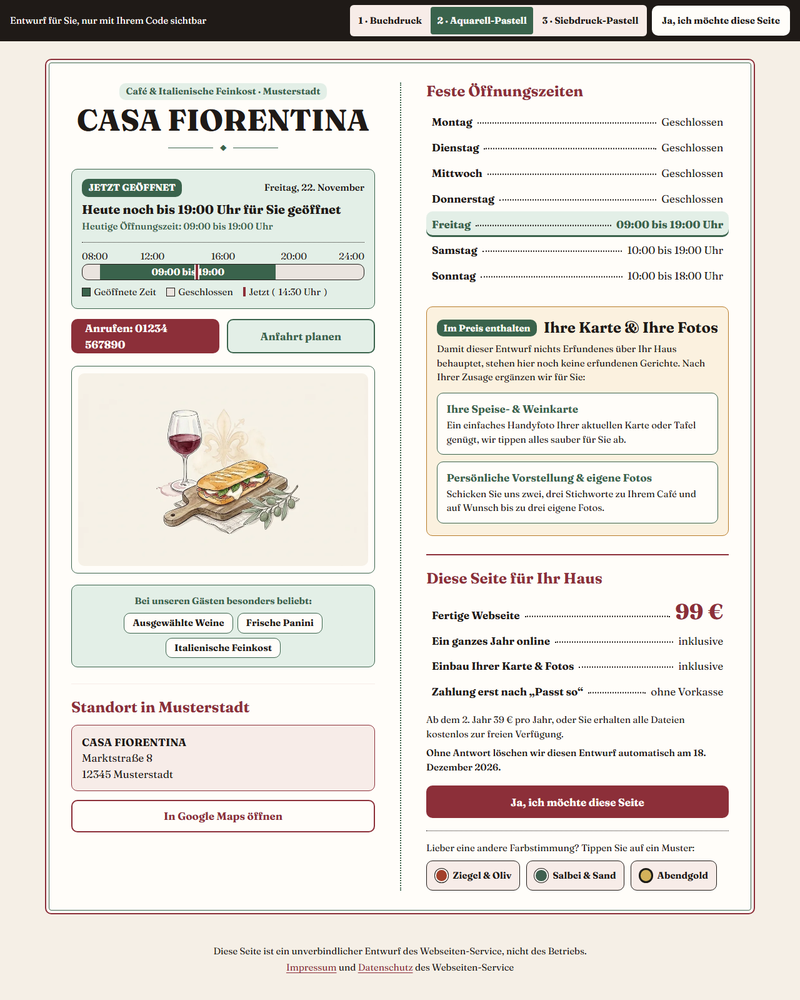

### Variante 3: Siebdruck-Pastell (Zustand: Feierabend am Sonntag, 20:15 Uhr mit nächster Öffnung)
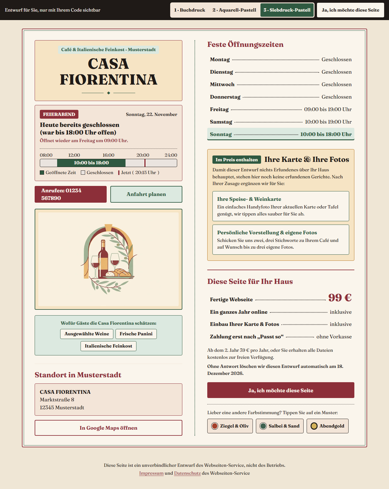

### Variante 1: Klassischer Buchdruck / Linolschnitt (Desktop 1280 px & Handy 390 px)
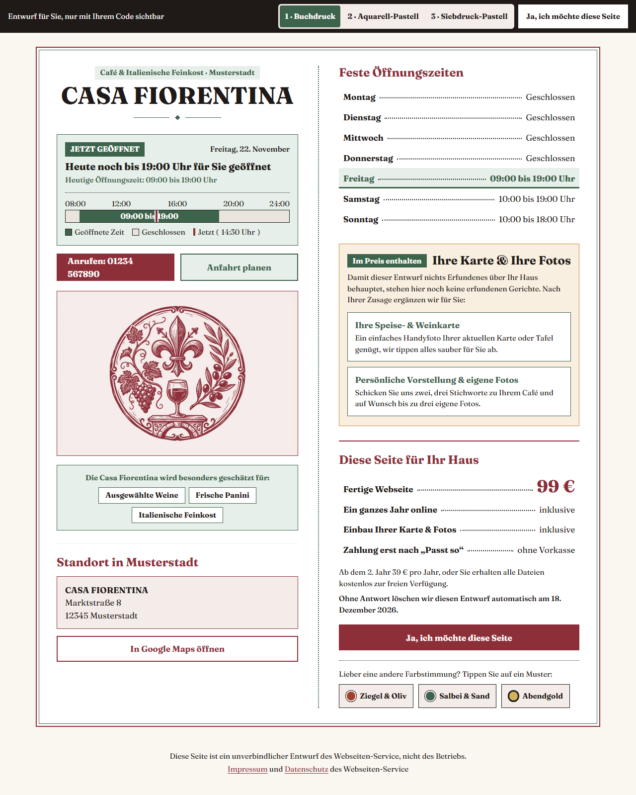
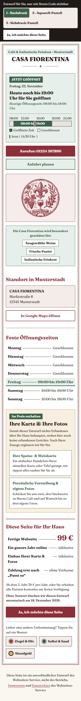

---

## 2. EISCAFÉ FONTANA (Piazza-Karte · 3 Varianten)

### Variante 2: Aquarell & Pastell (Zustand: Geöffnet am Freitag, 15:30 Uhr)
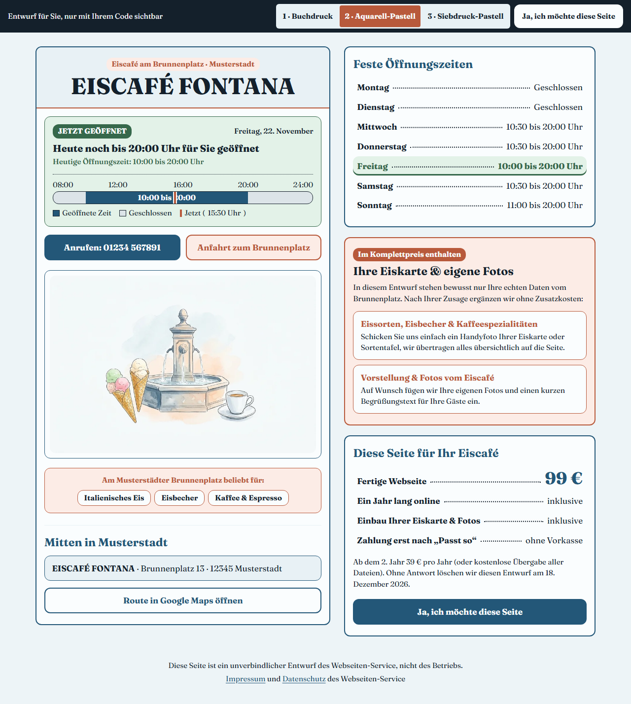

### Variante 3: Siebdruck-Pastell (Zustand: Ruhetag am Montag mit nächster Öffnung am Mittwoch)
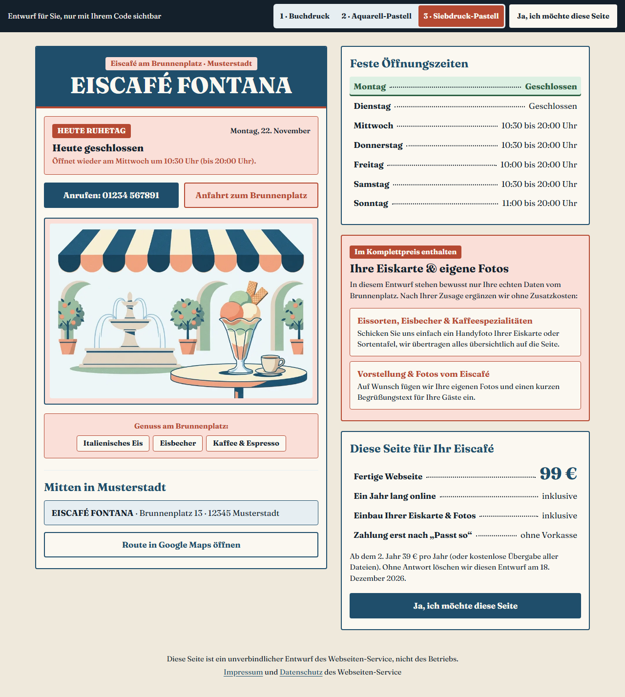

### Variante 1: Klassischer Buchdruck / Linolschnitt (Desktop 1280 px & Handy 390 px)
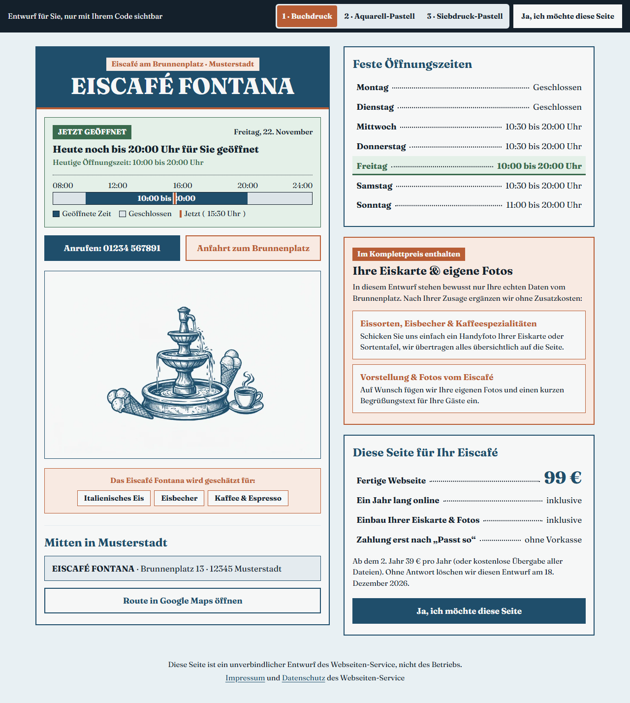
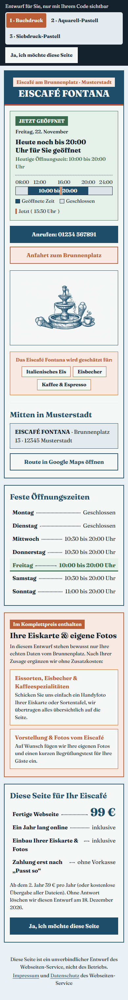

---

## 3. Karim Imbiss (Streetfood-Plakat · 3 Varianten)

### Variante 2: Aquarell & Pastell (Zustand: Geöffnet um 18:30 Uhr)
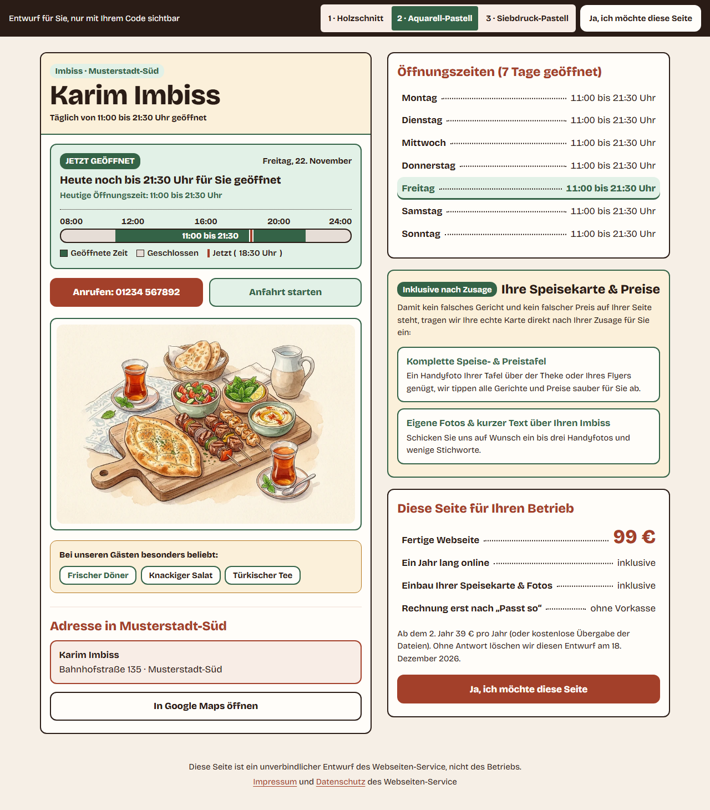

### Variante 3: Siebdruck-Pastell (Zustand: Feierabend um 22:30 Uhr mit Öffnung morgen)
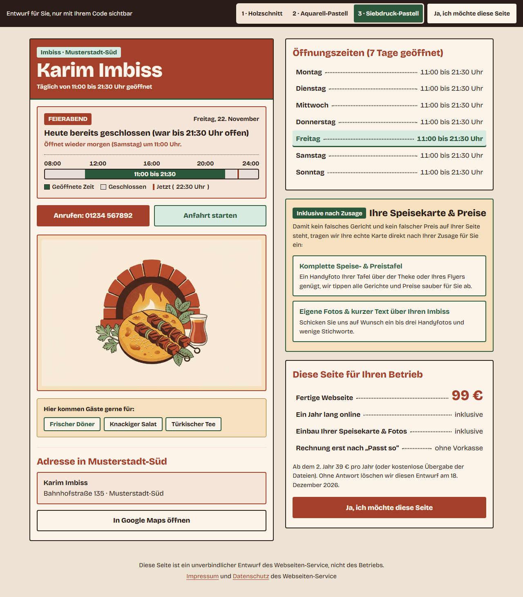

### Variante 1: Klassischer Holzschnitt (Desktop 1280 px & Handy 390 px)
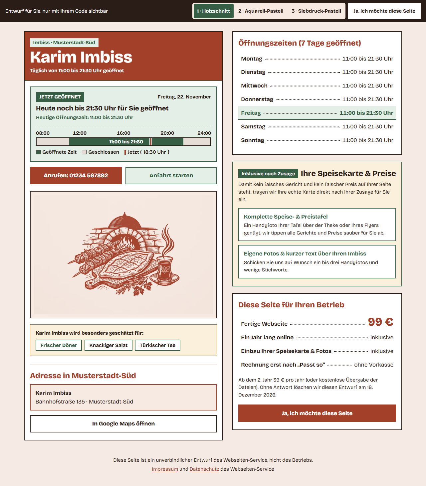
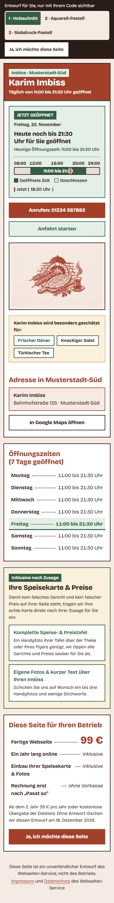

---

## Aufbau des Repositories

| Ordner / Datei                        | Inhalt                                                                                                                      |
| ------------------------------------- | --------------------------------------------------------------------------------------------------------------------------- |
| `Gegenentwurf_Gemini/index.html`      | **Interaktive Vergleichsbühne:** Alle 3 Gemini-Varianten je Geschäft nebeneinander, Vergleich mit Claude und Zeit-Simulator |
| `Gegenentwurf_Gemini/casa-florentina` | 2-spaltiges Menü-Buch in 3 Varianten (`v1` Buchdruck, `v2` Aquarell-Pastell, `v3` Siebdruck-Pastell)                        |
| `Gegenentwurf_Gemini/eiscafe-fontana` | Piazza- & Eiscafé-Karte in 3 Varianten (`v1` Buchdruck, `v2` Aquarell-Pastell, `v3` Siebdruck-Pastell)                      |
| `Gegenentwurf_Gemini/karim-imbiss`    | Streetfood- & Imbiss-Plakat in 3 Varianten (`v1` Holzschnitt, `v2` Aquarell-Pastell, `v3` Siebdruck-Pastell)                |
| `Test_echte_Betriebe/`                | Bisherige 5 Beispielseiten von Claude (basierend auf Entwurf D, Abreißkalender)                                             |
| `A_hallmark/` bis `D_kombination/`    | Erste 4 Grundentwürfe am erfundenen Musterbetrieb                                                                           |
| `fonts/`                              | Lokal eingebundene Schriften unter SIL Open Font License (`Fraunces`, `Literata`, `Bricolage Grotesque`)                    |
